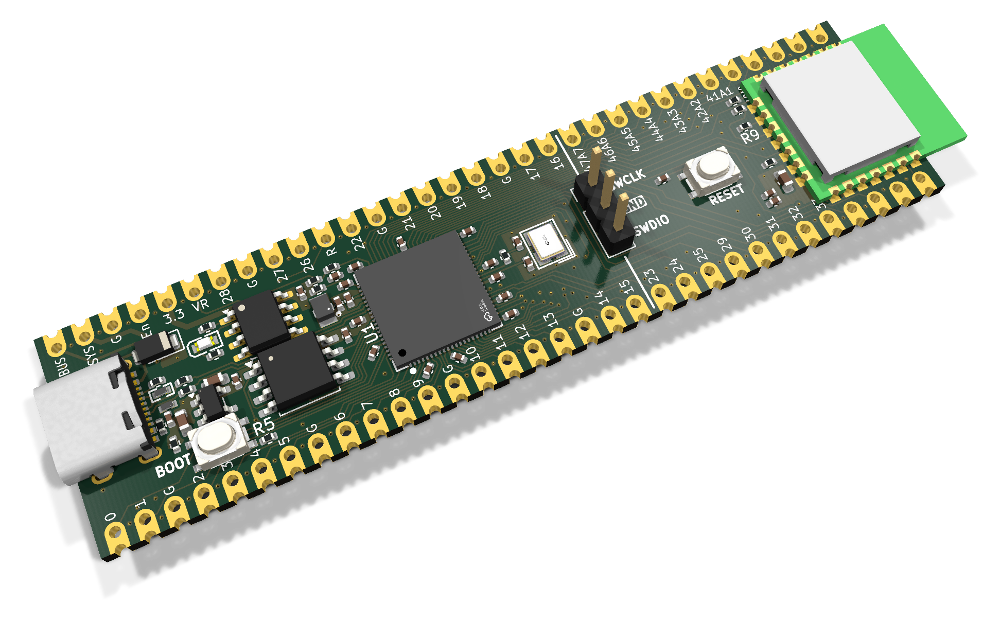
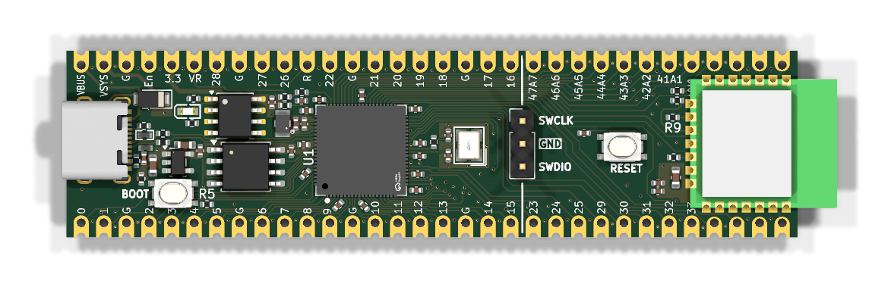
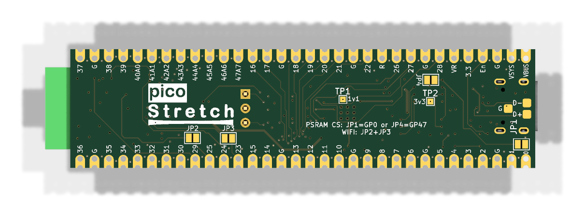

# Pico Stretch 2

An RP2350B dev board that breaks out all 48 GPIO pins while following the original Raspberry Pi Pico footprint for the first 20 pins on each side. It adds another 12 pins on each side — keeping the same 0.1" pitch and castellated edges so it remains breadboard-friendly.

The board supports PSRam (chip select on GP0 or GP47) and the Radio Module 2 for WiFi/BT

Features:
- USB-C connector
- Boot/Reset buttons
- SWDIO debugging header
- Radio Module 2 footprint / jumpers
- PSRam footprint / jumper
- Breaks out all 48 GPIOs
- Supports existing Pi Pico pinout projects (if there's room for a little overhang, or if you want to get adventuresome and saw the board in half)


<p align="center">
  
</p>

## Board views

**Top**



**Bottom**



## PCB layout

**F.Cu / F.Silkscreen**


**B.Cu / B.Silkscreen (mirrored)**


## Pinout

```
1   GPIO0           64  VBUS
2   GPIO1           63  VSYS
3   GND             62  GND
4   GPIO2           61  3v3_EN
5   GPIO3           60  3v3
6   GPIO4           59  ADC_VREF
7   GPIO5           58  GPIO28
8   GND             57  GND
9   GPIO6           56  GPIO27
10  GPIO7           55  GPIO26
11  GPIO8           54  RUN
12  GPIO9           53  GPIO22
13  GND             52  GND
14  GPIO10          51  GPIO21
15  GPIO11          50  GPIO20
16  GPIO12          49  GPIO19
17  GPIO13          48  GPIO18
18  GND             47  GND
19  GPIO14          46  GPIO17
20  GPIO15          45  GPIO16
21  GPIO23          44  GPIO47/ADC7
22  GPIO24          43  GPIO46/ADC6
23  GPIO25          42  GPIO45/ADC5
24  GPIO29          41  GPIO44/ADC4
25  GPIO30          40  GPIO43/ADC3
26  GPIO31          39  GPIO42/ADC2
27  GPIO32          38  GPIO41/ADC1
28  GPIO33          37  GPIO40/ADC0
29  GPIO34          36  GPIO39
30  GPIO35          35  GPIO38
31  GND             34  GND
32  GPIO36          33  GPIO37
```

## Optional parts and pin notes

- **PSRAM (U6)** is not fitted by default. Solder an APS6404L-3SQR (3.3 V, SOP-8) and close **one** of the
  chip-select jumpers on the back: JP1 puts it on GPIO0, JP4 on GPIO47 (the RP2350 can use either as its
  second QSPI chip select, QMI CS1n). Never close both. GPIO47 keeps GPIO0 free for UART0 TX and matches other
  RP2350B PSRAM boards; the jumper you close takes that pin away from the castellated pad.
- **Radio (U5, Raspberry Pi RM2)** is not fitted by default. GPIO24 (data/IRQ) and GPIO29 (clock) are wired
  straight to its pads; GPIO25 (CS) and GPIO23 (WL_ON) go through JP2 and JP3. With the radio fitted and
  the jumpers closed, all four belong to the radio.
- The RM2 antenna hangs past the end of the board. If you solder this board onto a carrier that extends
  under that end, keep copper off the carrier under and around the antenna.
- Wi-Fi transmit is bursty. The 3.3 V supply is a linear regulator, so avoid sustained full-rate transmit
  and keep extra load on the 3V3 pin modest. Keep VSYS above about 3.5 V.
- The flash and PSRAM share a QSPI bus with three loads and no series resistors. The Pico 2 runs its flash
  at `PICO_FLASH_SPI_CLKDIV 2`. If you see flash or PSRAM errors at higher system clocks, use a larger
  divider (4) and test before going back down.

## Back side

- Every castellated pad is labelled on the back too, with the same text as the front.
- Jumpers: JP1 = PSRAM CS on GPIO0, JP4 = PSRAM CS on GPIO47, JP2 + JP3 = radio (see above).
- Test pads: TP1 = 1V1, TP2 = 3V3, TP3 = USB D-, TP4 = USB D+ (on the connector side of the 33 Ω
  resistors, labelled D- and D+).

## Production files for JLCPCB

Production files live in the `production/` directory:

- `pico-stretch2.zip` — zipped Gerber files
- `bom.csv` — bill of materials
- `positions.csv` — component placement file

When ordering:

- Choose epoxy-filled and capped vias: the board has vias in pads.
- Select the castellated holes option.
- Use the JLC04161H-7628 stackup (set in the board file).
- U6 (PSRAM) is marked DNP and left out of the BOM and placement files; clear DNP if you want JLC to fit it.
- L1 (AOTA-B201610S3R3-101-T, C42411119) is often out of stock at JLC: pre-order it into your JLC parts
  library or consign it. Do not substitute another inductor; the RP2350 regulator needs this
  polarity-marked part.
- Check pin 1 of U1, U3, U4 and the diodes in JLC's placement preview.

## Regenerating images

Run [`scripts/render-images.sh`](scripts/render-images.sh) after PCB changes to regenerate everything in `images/`. Requires `kicad-cli` (KiCad ≥ 9) and ImageMagick (`magick`).
